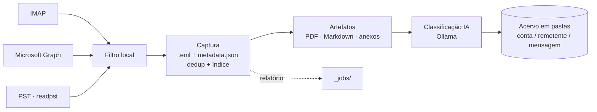

<div align="center">

# 📬 email-organizer

**Transforme caixas de e-mail em um acervo documental organizado, auditável e pronto para uso jurídico.**

Captura de IMAP, Microsoft Graph e PST · original preservado byte a byte · PDFs e Markdown de cada mensagem e anexo · classificação por IA local · interface web simples

[](https://www.python.org/)
[](https://fastapi.tiangolo.com/)
[](https://docs.docker.com/compose/)
[](https://ollama.com/)
[](LICENSE)

[Recursos](#-recursos) ·
[Início rápido](#-início-rápido) ·
[Configuração](#%EF%B8%8F-configuração) ·
[Credenciais](#-credenciais) ·
[Uso](#-uso) ·
[Saída](#-estrutura-de-saída) ·
[Segurança](#-backup-e-segurança) ·
[Licença](#-licença-e-créditos)

</div>

---

## 💡 Sobre

O **email-organizer** lê suas caixas postais **sem alterá-las** e grava cada mensagem como um
diretório autocontido: o `.eml` original intocado, um `metadata.json` com tudo o que se sabe sobre
ela e artefatos derivados (PDF da mensagem, PDF de cada anexo, Markdown do texto). O resultado é
um repositório de evidências navegável por qualquer explorador de arquivos, sincronizável com a
nuvem e fácil de juntar a processos, dossiês e cronologias.

> **Unidade fundamental:** 1 mensagem = 1 diretório = 1 `metadata.json` = N artefatos derivados.

## ✨ Recursos

| | |
|---|---|
| 🔒 **Origem somente leitura** | IMAP com `EXAMINE` + `BODY.PEEK`, Graph só com `Mail.Read`, PST montado como somente leitura. Nada é apagado, movido ou marcado como lido. |
| 🧾 **Cadeia de evidência** | `original/mensagem.eml` byte a byte, SHA-256 de todo artefato, rastreio de origem (conta, pasta, UID). |
| 📥 **Três fontes, um formato** | Gmail/Hostinger/qualquer IMAP, Hotmail/Outlook.com/365 via Graph e PSTs legados (sem Outlook), todos convergindo para `.eml`. |
| 📄 **Artefatos prontos** | PDF da mensagem com imagens na posição, cada anexo convertido em PDF (Office, imagens, HTML, `.eml`/`.msg` aninhados), Markdown do corpo. |
| 🧠 **IA que só enriquece** | Classificação por categoria via Ollama na sua rede, com JSON Schema. Nunca decide caminho ou exclusão. |
| ♻️ **Incremental e deduplicado** | Baixa só o que é novo; a mesma mensagem vinda de várias fontes vira um único diretório. |
| 🖥️ **Interface web** | Processar, acompanhar jobs em tempo real, reprocessar, conectar contas, limpeza com lixeira. |
| 🧱 **Simples de manter** | Sem banco, fila ou SPA. Arquivos + JSON, uma imagem Docker, pastas externas. |

## 🔄 Como funciona



| Fonte | Uso | Autenticação |
|---|---|---|
| **IMAP** | Gmail, Hostinger, qualquer servidor IMAP | senha de app / senha da caixa |
| **Microsoft Graph** | Hotmail, Outlook.com, Microsoft 365 | OAuth (device code), app próprio no Entra |
| **PST** | arquivos legados do Outlook | — (`readpst`, sem precisar do Outlook) |

Mensagens recebidas **e** enviadas são processadas; a direção é inferida pelas contas próprias.

**Stack:** Python 3.12 · Pydantic v2 · FastAPI · Jinja2 · HTMX · Tailwind · WeasyPrint · PyMuPDF ·
LibreOffice headless · readpst (libpst) · MSAL · httpx · Ollama

## 🚀 Início rápido

**Pré-requisito:** [Docker Desktop](https://www.docker.com/products/docker-desktop/).

```powershell
# 1. pastas do host (output, estado, PSTs)
copy .env.example .env          # edite os caminhos

# 2. configuração das fontes (sem senhas), na pasta de output
copy config.example.json <OUTPUT_DIR>\config.json

# 3. senhas IMAP, na pasta de estado (fora de pastas sincronizadas)
#    <ESTADO_DIR>\segredos.json  →  { "Gmail pessoal": "abcdefghijklmnop" }

# 4. subir
docker compose up -d --build app
```

Abra **<http://localhost:8080>**, marque as fontes e clique em **Processar**.

> Contas Microsoft precisam de um app registrado no Entra e de uma conexão inicial
> (botão **conectar**). Veja [Credenciais](#-credenciais).

---

## 🛡️ Garantias

- **Origem somente leitura.** Nunca apaga, move, marca como lida ou altera mensagens.
- **Original byte a byte.** `original/mensagem.eml` é gravado uma vez e nunca mais alterado, com SHA-256 registrado. Todo artefato deriva dele.
- **`metadata.json` é a fonte de verdade.** Cada rotina só acrescenta/atualiza as próprias chaves.
- **Escrita atômica.** JSON e arquivos em `tmp` + rename; diretórios montados em `.tmp-<id>/` e renomeados no fim. Nada fica pela metade.
- **Reprocessar nunca acessa a caixa postal.** Tudo é regenerado a partir do `.eml` salvo.
- **IA só enriquece.** Nunca decide fluxo, caminho ou exclusão.

## 📁 Pastas do sistema

As pastas do host são definidas no `.env` (modelo: [`.env.example`](.env.example)), lido pelo `docker compose`.

| Pasta | Variável | No container | Conteúdo | Sincronizar? |
|---|---|---|---|---|
| **Output** | `OUTPUT_DIR` | `/output` | `config.json`, mensagens, `_index.json`, `_jobs/`, `.lixeira/` | ✅ **Sim** — é o acervo |
| **Estado** | `ESTADO_DIR` | `/estado` | `segredos.json`, `tokens/`, `imap/`, `graph/` | ⛔ **Não** — contém segredos |
| **PSTs** | `PST_DIR` | `/pst` (somente leitura) | `*.pst` | — |

```ini
OUTPUT_DIR=D:/Sincronizado/Emails       # acervo
ESTADO_DIR=D:/.estado                   # segredos e estado incremental — FORA da nuvem
PST_DIR=C:/Users/voce/OneDrive/Outlook  # PSTs (somente leitura)
```

Fora do Docker, use `--output <pasta> --estado <pasta>` (ou `EMAIL_ORGANIZER_ESTADO`). Sem `--estado`, o padrão é `<output>/.estado`.

### Pasta de estado

```
<ESTADO_DIR>/
├── segredos.json                 # senhas IMAP por nome de fonte (único item que não se recria)
├── tokens/<conta>.json           # cache OAuth do Graph (refaz com "conectar")
├── imap/<conta>/<pasta>.json     # UIDVALIDITY + UIDs já capturados
└── graph/<conta>/<pasta>.json    # ids Graph já capturados
```

**Por que separada?** O output é sincronizado com a nuvem; senhas e tokens dão acesso às caixas
postais e não podem ir junto. `imap/` e `graph/` guardam o que já foi lido, para baixar só o que é
novo. Nada nela é evidência: o acervo continua íntegro sem ela.

<details>
<summary><b>Como recriar a pasta de estado em caso de perda</b></summary>

1. Crie a pasta e confira `ESTADO_DIR` no `.env`.
2. **`segredos.json`** — gere novas senhas de app (Gmail, Hostinger) e grave-as no formato de [segredos.json](#segredosjson). Se o disco foi perdido/roubado, revogue as antigas.
3. **`tokens/`** — reconecte cada fonte Graph (botão **conectar** ou `conectar "<fonte>"`). Se o disco foi perdido, revogue as sessões em <https://account.live.com/consent/Manage>.
4. **`imap/` e `graph/`** — nada a fazer: a próxima execução relê as caixas e a deduplicação descarta o que já existe.
5. `docker compose up -d app` e processe normalmente.

> Guarde as senhas de app num gerenciador de senhas; assim o passo 2 é só copiar.
>
> Apagou o output à mão? Apague também `imap/` e `graph/` (ou use `reiniciar --confirmar`), senão as mensagens já registradas não são lidas de novo.

</details>

## 🐳 Instalação

### Docker (recomendado)

Rode sempre na pasta do projeto (onde estão `docker-compose.yml` e `.env`).

| Ação | Comando |
|---|---|
| Buildar a imagem | `docker compose build app` |
| Buildar do zero | `docker compose build --no-cache app` |
| Subir a interface | `docker compose up -d app` → <http://localhost:8080> |
| Buildar e subir (após mudar o código) | `docker compose up -d --build app` |
| Status / log | `docker compose ps` · `docker compose logs -f app` |
| Reiniciar / parar | `docker compose restart app` · `docker compose stop app` |
| Parar e remover o container | `docker compose down` (não apaga dados) |
| Comando do CLI | `docker compose run --rm app python -m email_organizer <comando>` |
| Suíte de testes completa | `docker compose --profile dev run --rm dev` |

- `restart: unless-stopped`: o container volta sozinho quando o Docker inicia.
- Mudou o `.env`? `docker compose up -d app` recria o container com as novas pastas.
- Se um build falhar (ex.: rede), o container antigo continua rodando com o código anterior.

### Local (desenvolvimento)

```powershell
python -m venv .venv
.venv/Scripts/pip install -e ".[dev]"
```

Captura, IMAP, Graph e IA funcionam localmente. WeasyPrint, LibreOffice e readpst no Windows são
frágeis: gere PDFs e leia PSTs no container.

## ⚙️ Configuração

### `config.json`

Fica na raiz do output e **não contém senhas**. Modelo completo em [`config.example.json`](config.example.json).

```json
{
  "contas_proprias": [],
  "filtros": { "cliente-2025": { "remetente": ["mariana"], "data_de": "2025-01-01" } },
  "imap": [
    { "ativo": true, "nome": "Gmail pessoal", "host": "imap.gmail.com", "porta": 993, "ssl": true,
      "usuario": "voce@gmail.com", "pastas": ["INBOX"] }
  ],
  "graph": [
    { "ativo": false, "nome": "Hotmail", "usuario": "voce@hotmail.com",
      "client_id": "<ID do aplicativo (cliente)>", "tenant": "consumers",
      "pastas": ["Caixa de Entrada/Mariana"] }
  ],
  "pst": [ { "ativo": false, "nome": "Servicos", "caminho": "/pst/Servicos.pst", "pastas": [] } ],
  "ollama": { "habilitado": true, "url": "http://192.168.0.10:11434", "modelo": "qwen2.5:7b", "timeout_s": 120 },
  "opcoes": { "pdf_principal": true, "markdown": true, "classificacao": true,
              "baixar_imagens_remotas": true, "timeout_conversao_s": 120, "trabalhadores": 0 },
  "categorias": ["Banco", "Seguros", "Imóveis", "Contratos", "Procurações", "Trabalhista",
                 "Tributário", "Processo Judicial", "Cartão de Crédito", "Outros"]
}
```

| Chave | Significado |
|---|---|
| `contas_proprias[]` | seus e-mails (definem `direcao: enviada`). Os `usuario` de IMAP/Graph entram automaticamente. |
| `imap[]` | `ativo`, `nome` (único; chave do `segredos.json`), `host`, `porta`, `ssl`, `usuario`, `pastas[]`, `filtro`. |
| `graph[]` | `ativo`, `nome`, `usuario`, `client_id`, `tenant` (`consumers` = Hotmail/Outlook.com; `organizations` ou id = 365), `pastas[]`, `filtro`. |
| `pst[]` | `ativo`, `nome`, `caminho` (**dentro do container**, ex. `/pst/X.pst`), `pastas[]`, `filtro`. |
| `pastas[]` | vazio = todas; preenchido = só essas (sem diferenciar maiúsculas; subpastas com `/`). |
| `ollama` | servidor, modelo e timeout. `habilitado: false` desliga a IA. |
| `opcoes.trabalhadores` | processos paralelos para artefatos (0 = metade dos núcleos). |
| `categorias[]` | lista fechada usada pela IA; resposta fora dela vira `Outros`. |

> **Gmail:** evite `pastas` vazio. `[Gmail]/Todos os e-mails` repete todas as mensagens (a dedup
> resolve, mas fica bem mais lento). `pastas "<fonte>"` mostra os nomes disponíveis.

### Filtros

Selecionam o que é capturado; mensagem filtrada não é gravada, só contada no relatório.

**Critérios** — E entre critérios, OU dentro de cada lista, texto por trecho sem maiúsculas/acentos:
`data_de`, `data_ate`, `remetente[]`, `destinatario[]` (To/Cc/Bcc), `assunto[]`, `corpo[]`,
`com_anexo`, `excluir_remetente[]`.

```jsonc
"pastas": [
  "INBOX",                                                       // sem filtro próprio
  { "nome": "Clientes", "filtro": { "data_de": "2024-01-01" } }, // filtro inline
  { "nome": "Mariana", "filtro": "cliente-2025" }                // filtro nomeado
],
"filtro": { "excluir_remetente": ["noreply"] }                   // demais pastas da fonte
```

A decisão é sempre local (o servidor só recebe pré-filtro por data), então as três fontes dão o
mesmo resultado. O filtro aplicado fica em `origem.filtro` no `metadata.json`.

### `segredos.json`

Na pasta de estado, indexado pelo `nome` da fonte IMAP:

```json
{ "Gmail pessoal": "abcdefghijklmnop", "Gmail secundario": "qrstuvwxyzabcdef", "Advocacia": "senha-da-caixa" }
```

Fonte sem senha falha com `AUTHENTICATIONFAILED`. Graph não usa este arquivo (usa `tokens/`).

## 🔑 Credenciais

<details>
<summary><b>Gmail — senha de app (IMAP)</b></summary>

O Gmail **não aceita a senha normal** por IMAP: é preciso uma *senha de app* (16 letras), que
exige verificação em duas etapas.

1. **Verificação em duas etapas:** <https://myaccount.google.com> → **Segurança** → **Verificação em duas etapas** → ativar.
2. **Senha de app:** <https://myaccount.google.com/apppasswords>.
   - **Confira o avatar no canto superior direito**: a senha é criada para a conta logada. Com várias contas abertas, é fácil gerar na errada.
   - Nome `email-organizer` → **Criar**. As 16 letras (`abcd efgh ijkl mnop`) aparecem **uma vez só**; com ou sem espaços funciona.
   - Cole no `segredos.json`, na chave com o `nome` da fonte.
3. **IMAP ativo:** Gmail → ⚙️ **Ver todas as configurações** → **Encaminhamento e POP/IMAP** → **Ativar IMAP** (contas recentes já vêm ativas).
4. **Teste:** `python -m email_organizer pastas "Gmail pessoal"`.

| Sintoma | Causa provável |
|---|---|
| `AUTHENTICATIONFAILED` com 16 letras | senha de **outra** conta; copiada incompleta; recém-criada (aguarde 1–2 min) |
| `AUTHENTICATIONFAILED` sem 16 letras | é a senha normal da conta |
| "configuração não disponível" | 2 etapas desativada, Proteção Avançada ou Workspace bloqueado pelo admin |
| `not enabled for IMAP use` | IMAP desativado |

**Revogar:** <https://myaccount.google.com/apppasswords>. Trocar a senha da conta revoga todas.

</details>

<details>
<summary><b>Hostinger e outros IMAP de domínio próprio</b></summary>

Não há senha de app: usa-se a senha da caixa.

1. hPanel → **E-mails** → domínio → **Contas de e-mail** → **⋯ → Alterar senha** (se necessário).
2. Servidor `imap.hostinger.com`, porta `993`, SSL (já no `config.example.json`).
3. Senha no `segredos.json` com o `nome` da fonte; teste com `pastas "<fonte>"`.

</details>

<details>
<summary><b>Microsoft (Hotmail, Outlook.com, 365) — Graph</b></summary>

A Microsoft desativou senha básica em IMAP para Outlook.com; o acesso é via Graph com OAuth.
Registre **um app seu, gratuito**, no Microsoft Entra (uma vez). Ele não tem segredo: só um
*client_id* público e a permissão de leitura.

**1. Portal** — <https://entra.microsoft.com> com a conta Microsoft. O portal exige MFA; se pedir
o Microsoft Authenticator, escolha "aplicativo autenticador diferente" (Google Authenticator,
1Password…) ou "método diferente" (SMS, passkey).

**2. Registrar o app** — **Entra ID → Registros de aplicativo → + Novo registro**:
- Nome `email-organizer`; tipo de conta **Somente contas pessoais da Microsoft** (para 365, inclua contas organizacionais); sem URI de redirecionamento.
- Aviso de "aplicativos fora de um diretório preterido": ignore, registre no **Diretório Padrão**.

**3. Cliente público** — **Authentication → Configurações → Permitir fluxos de cliente público = Sim** → Salvar
(ou no **Manifesto**: `"isFallbackPublicClient": true`).

**4. Permissão** — **Permissões de APIs → + Adicionar → Microsoft Graph → Delegadas → `Mail.Read`**.
Não marque nada com escrita. Resultado: `Mail.Read` e `User.Read` (delegadas).

**5. client_id** — **Visão geral → ID do aplicativo (cliente)** → `config.json`:
`"client_id": "<id>"`, `"tenant": "consumers"`. Não use o ID do diretório nem o do objeto.

**6. Conectar** — botão **conectar** na interface, ou:

```powershell
docker compose run --rm app python -m email_organizer conectar "Hotmail"
```

Abra a URL, digite o código (vale 15 min, só o mais recente é válido), entre com a conta e aceite.
O token fica em `<ESTADO_DIR>/tokens/` e se renova sozinho.

**Revogar:** <https://account.live.com/consent/Manage> → `email-organizer`; ou apague `tokens/<conta>.json`.

</details>

## 🧭 Uso

### Interface web

`docker compose up -d app` → **<http://localhost:8080>** (local, sem login).

| Tela | O que faz |
|---|---|
| **Processar** | marca fontes e, opcionalmente, pastas só para este job; opções PDF/Markdown/IA; progresso ao vivo (etapas, contadores, barras), cancelar, relatório e últimos jobs. |
| **Reprocessar** | refaz artefatos e/ou classificação a partir do `.eml` salvo. |
| **Conectar** | autoriza contas Microsoft (código em destaque, tempo restante, novo código se expirar). |
| **Rotinas → Limpeza** | árvore conta → `.enviadas`/destinatário · remetente → mensagens; marque e mova para a lixeira. |
| **Rotinas → Lixeira** | `.lixeira/` na raiz do output, um lote por exclusão; restaurar, excluir lote ou esvaziar (definitivo, com confirmação). |

### CLI

`python -m email_organizer [--output PASTA] [--estado PASTA] <comando>`

| Comando | O que faz |
|---|---|
| `pastas "<fonte>"` | lista as pastas de uma fonte (testa credenciais) |
| `conectar "<fonte Graph>"` | autoriza uma conta Microsoft (device code) |
| `processar` | processa as fontes `ativo: true` |
| `processar --fonte "<nome>"` | só a(s) fonte(s) indicada(s) (repetível; ignora `ativo`) |
| `processar --sem-artefatos` / `--sem-classificacao` | só captura / sem IA |
| `classificar [--todas]` | classifica pendentes (ou tudo) sem acessar a caixa |
| `reconstruir-indice` | recria `_index.json` varrendo os diretórios |
| `reorganizar [--confirmar]` | move mensagens de layouts antigos para o atual (sem `--confirmar` só lista) |
| `reiniciar [--confirmar]` | apaga acervo e estado incremental; mantém `config.json`, `segredos.json` e `tokens/` |

```powershell
docker compose run --rm app python -m email_organizer processar --fonte "Gmail pessoal"
docker compose run --rm app python -m email_organizer classificar
```

## 📂 Estrutura de saída

```
<OUTPUT_DIR>/
├── config.json
├── _index.json                              # chave de dedup → caminho (reconstruível)
├── _jobs/<AAAA-MM-DD_HH-MM-SS>/             # log.txt, relatorio.json, relatorio.md
├── .lixeira/<lote>/                         # itens movidos pela limpeza
└── <conta>/                                 # conta que recebeu (e-mail) ou pst-<arquivo>
    ├── .enviadas/<destinatário>/<mensagem>/ # enviadas, pelo 1º destinatário
    └── <remetente>/
        └── AAAA-MM-DD_HH-MM-SS_<assunto>_<id6>/
            ├── metadata.json                # fonte de verdade
            ├── original/mensagem.eml        # byte a byte, nunca alterado
            ├── mensagem.pdf                 # cabeçalhos + corpo com imagens + lista de anexos
            ├── mensagem-texto.md            # texto do corpo
            ├── corpo/imagem-001.pdf …       # imagens do corpo, ampliadas para A4
            └── anexos/
                ├── originais/<nome>         # anexo original
                ├── <nome>.pdf               # anexo convertido
                └── emails/<id6>/            # e-mail anexado: mesma estrutura, recursiva
```

- A mesma mensagem recebida em duas contas é guardada **uma vez**, na pasta da 1ª conta lida; as demais origens ficam em `origens_adicionais`.
- Sem remetente → `_sem-remetente/`; enviada sem destinatário → `_sem-destinatario/`. Nomes limitados a ~200 caracteres (Windows).
- Anexos: PDF copiado; imagens via PyMuPDF; Office/ODF/RTF/TXT via LibreOffice; HTML via WeasyPrint; `.eml`/`.msg` recursivos; TNEF expandido. **zip/rar/7z** e assinaturas são guardados mas não convertidos.

<details>
<summary><b>Exemplo de <code>metadata.json</code></b></summary>

Schema completo em [`specs/metadata.md`](specs/metadata.md).

```json
{
  "schema_version": 1,
  "id": "8e4c2b9a1f03",
  "chave_dedup": { "tipo": "message_id", "valor": "<123@dominio.com>" },
  "origem": { "tipo": "imap", "conta": "voce@gmail.com", "pasta": "INBOX", "uid": 48213 },
  "origens_adicionais": [],
  "direcao": "recebida",
  "data": "2026-10-29T14:33:10-03:00",
  "assunto": "Financiamento Imobiliário",
  "remetente": { "nome": "João Silva", "email": "joao@email.com" },
  "original": { "arquivo": "original/mensagem.eml", "sha256": "…", "tamanho": 183223 },
  "anexos": [ { "ordem": 1, "nome_original": "contrato.docx", "status": "convertido" } ],
  "thread": { "tipo": "resposta", "pai_message_id": "<120@dominio.com>", "metodo": "cabecalho" },
  "classificacao": { "categoria": "Imóveis", "subcategoria": "Financiamento Imobiliário",
                     "confianca": 0.9, "modelo": "qwen2.5:7b" },
  "pipeline": { "captura": { "status": "ok" }, "artefatos": { "status": "ok" },
                "classificacao": { "status": "ok" } },
  "avisos": []
}
```

</details>

## 🧠 Classificação por IA

- O Ollama roda em outra máquina da rede (`ollama.url`); nenhuma IA dentro da imagem e nenhum dado enviado a serviços externos.
- Uma chamada por mensagem (assunto, remetente, até 3000 caracteres do corpo, nomes dos anexos), resposta forçada por JSON Schema e validada.
- Grava `classificacao` e, sem cabeçalhos de thread, infere `thread.tipo` (`metodo: ia`).
- Ollama fora do ar → `pendente`, o lote não insiste; rode `classificar` depois.

## ♻️ Incremental, deduplicação e reprocessamento

- **Incremental:** IMAP guarda UIDs por pasta (+ `UIDVALIDITY`); Graph guarda ids. Só o que é novo é baixado.
- **Dedup:** `Message-ID` normalizado; sem ele, hash de remetente/data/assunto; sem cabeçalhos, hash do `.eml`.
- **Reprocessamento:** regenera artefatos/classificação que não estão `ok`, sempre a partir do `.eml`.
- **PST:** convertido com `readpst`. Feche o Outlook ou use uma cópia do arquivo.

## 🔐 Backup e segurança

| Item | Onde | Backup |
|---|---|---|
| Acervo (mensagens, PDFs, `metadata.json`) | `OUTPUT_DIR` | ✅ pasta sincronizada |
| `config.json` (sem senhas) | `OUTPUT_DIR` | ✅ vai junto |
| `segredos.json` | `ESTADO_DIR` | 🔑 gerenciador de senhas |
| `tokens/`, `imap/`, `graph/` | `ESTADO_DIR` | ♻️ recriáveis |

- `ESTADO_DIR` **fora** de qualquer pasta sincronizada.
- Dados reais só em arquivos ignorados pelo git: `.env`, `config.json`, `segredos.json`, `tokens/`, PSTs e o acervo. O repositório contém apenas exemplos fictícios.
- Logs nunca imprimem senhas ou tokens.
- A interface web não tem login: use apenas em `localhost`.

## 🩺 Solução de problemas

| Problema | Solução |
|---|---|
| `AUTHENTICATIONFAILED` (Gmail) | senha de app de 16 letras, da conta certa, IMAP ativo |
| `conta … não conectada` (Graph) | **conectar** de novo; token apagado ou revogado |
| Código do device flow expirado | gere um novo e digite em até 15 min |
| Portal Microsoft pede Authenticator | use outro app TOTP ou SMS |
| `pasta '…' inexistente` | use o nome exato de `pastas "<fonte>"` (subpastas com `/`) |
| Ollama indisponível | confira `ollama.url` (`curl http://IP:11434/api/tags`); depois `classificar` |
| Anexo `nao_convertido` | veja `avisos` no `metadata.json` / `relatorio.md`; o original está em `anexos/originais/` |
| Acentos quebrados no console | `$env:PYTHONIOENCODING="utf-8"` |

## 🛠️ Desenvolvimento

```powershell
.venv/Scripts/pytest -q                        # local (pula WeasyPrint/LibreOffice)
docker compose --profile dev run --rm dev      # suíte completa no container
.venv/Scripts/ruff check . ; .venv/Scripts/ruff format .
```

- Código em `src/email_organizer/`, testes em `tests/` (fixtures `.eml` fictícias).
- Specs e decisões (ADRs) em [`specs/`](specs/README.md); roadmap em [`specs/ondas.md`](specs/ondas.md).
- Convenções: português em identificadores, JSON, logs e specs; tipagem completa; Pydantic v2; mudança de schema incrementa `schema_version`.
- Novas rotinas sobre o acervo seguem o padrão: ler `metadata.json` → enriquecer → gerar artefatos.

## 📜 Licença e créditos

O código deste projeto está sob a **[licença MIT](LICENSE)**: use, copie, modifique e distribua
livremente, inclusive para fins comerciais, **mantendo o aviso de copyright e a referência a este
repositório como origem**.

> [!IMPORTANT]
> A licença MIT cobre **apenas o código deste repositório**. O projeto depende de bibliotecas e
> ferramentas de terceiros com licenças próprias — algumas com obrigações fortes, como
> **AGPL-3.0 (PyMuPDF)** e **GPL (extract-msg, readpst/libpst)**. Quem for usar, modificar ou
> distribuir (inclusive a imagem Docker) deve **verificar essas licenças antes do uso pretendido**.
> Veja [THIRD_PARTY.md](THIRD_PARTY.md). O software é fornecido "no estado em que se encontra",
> sem garantias; não constitui aconselhamento jurídico sobre o valor probatório dos artefatos.
